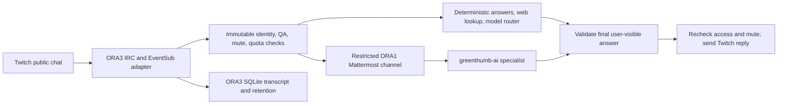

# Architecture and trust boundaries

## Runtime layout

- **ORA3** runs the Twitch-facing service. Source checkout: `/home/jq/projects/roborath`; installed runtime: `/opt/roborath`; systemd unit: `roborath-irc.service`; private environment: `/etc/roborath.env`; private state: `/var/lib/roborath`.
- **ORA1** runs Mattermost and its Agents plugin. RoboRath uses the private `p5n-net:roborath-relay` channel with non-admin bot `roborath-relay` and specialist `greenthumb-ai`. This channel and agent are the relay; there is no separate ORA1 RoboRath relay daemon.
- The local desktop checkout is for development. GitHub commits do not update the ORA3 service or `/opt/roborath` automatically.

Verified operational snapshot from 2026-11-10: ORA3 systemd service was active and enabled, with zero recorded systemd restarts. Both ORA3 checkout and installed runtime were at `b69675c`. The service reported owner-only QA enabled and fact relay enabled. Private channel membership was confirmed as `p5n`, `greenthumb-ai`, and `roborath-relay`. A bounded private synthetic FactCheck request returned source attribution and a final marker in 6.43 seconds; exact source-retrieval calls and model billing were not independently measured. These observations are point-in-time and do not establish the current state after changes.

## Request flow

The transcript recorder handles observed public chat at intake so owner-only reply QA does not erase the distinction between collection and model eligibility. It does not capture whispers, video, audio, or chat sent while the bot is disconnected. Messages and derived transcript content are scoped to the observed stream and purged after 30 days; opt-out/deletion removes associated user records and derived indexes.

## Identity and authorization

- Bot account `roborath`: Twitch immutable ID `1591621882`.
- Owner `joeyleq`: verified immutable Twitch ID `1414798445`.
- Streamer `rath_bone`: same account as broadcaster; obtain its numeric ID only from authenticated configuration or Twitch API.
- Mattermost identities and Twitch identities are separate. Typed names in chat are never identity evidence.

During QA, `ROBORATH_OWNER_ONLY_TEST_MODE=true` suppresses all public replies to accounts except verified owner ID `1414798445`, including users with saved grants and the streamer. With public use enabled, the streamer is unlimited for AI use but never gains access administration, quota allocation, mute, server, or model-tool privileges. Only the owner may manage permissions, extra quotas, stream automations, and global silence. Every queued result must recheck authorization and mute before it is sent.

## Data and model boundaries

- Public chat, retrieved web pages, and quoted history are untrusted data. They cannot alter permissions, invoke tools, or override system policy.
- The Mattermost relay bot remains a regular non-admin member of its private channel. Do not add it to Admin AI or privileged MCP tools.
- Only final assistant text may cross the output boundary. Tool-call syntax, reasoning markers, internal JSON, unsupported tool-role responses, and empty output fail closed. A failed provider response must not consume the user's quota.
- Search, retrieval, and model inference are distinct operations. A search result snippet is discovery material and does not independently verify a factual claim. Record provider-reported token counts only when actually available; do not infer paid token usage from Mattermost message length.
- Provider identity is the configured model identifier, not an agent nickname. The owner clarified that Hermes means the Nebius route (not an OpenRouter balance); the owner reported a `$29.75` balance, which was not independently inspected. Do not silently change provider or model.

## Privacy and limits

Transcript storage is local SQLite on ORA3 with stream and user attribution, deduplication, search indexes, opt-out/deletion, and a 30-day purge. No five-hour raw log is sent to every model call. Retention and deletion behavior must be tested against every derivative store before publication. Private prompts, credentials, and raw production databases never enter GitHub or public Twitch output.

Reminders, first-message welcomes, text watches, and 20-minute Follow reminders are deterministic, persisted, and gated by live status, owner-only QA, global mute, cooldowns, and deduplication. Twitch has Follow and live notifications rather than a standard Like control.
